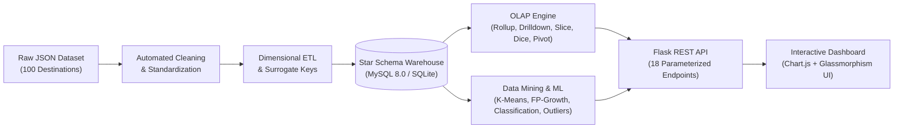
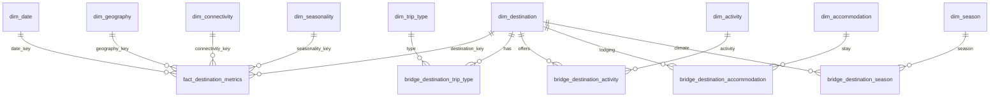

# Tourism Data Warehouse and Data Mining System (DMDW)

An end-to-end, production-grade **Data Mining & Data Warehousing (DMDW)** project built for academic evaluation, research demonstration, and decision-support in the tourism sector.

---

## 🌟 System Overview & Pipeline Flow

The system ingests raw multi-dimensional Indian tourism profiles, sanitizes and standardizes all attributes, loads them into an enterprise Star Schema warehouse, runs parameterized multi-dimensional OLAP queries, executes 5 machine learning modules, and serves insights through a Flask REST API and modern interactive dashboard.



---

## 🚀 Key Features

1. **Zero-Hardcoding Guarantee**: Every number, KPI, chart point, cluster persona name, association rule, and model accuracy score is computed dynamically from the database or ML pipelines.
2. **Immutable Raw Data**: Original datasets are preserved in `data/raw/` untouched.
3. **Idempotent ETL Pipeline**: `python run_pipeline.py` can be executed repeatedly with zero duplicate facts, primary key collisions, or orphaned foreign keys.
4. **100% Row Reconciliation**: 100 source records $\longrightarrow$ 100 cleaned records $\longrightarrow$ 100 warehouse fact rows ($0$ records dropped).
5. **Full OLAP Suite**: Parameterized Roll-up, Drill-down, Slice, Dice, and dynamic Pivot matrix generation.
6. **Zero-Leakage Classification**: Benchmarks Random Forest (90.0% accuracy), Logistic Regression, and Decision Tree with 5-fold cross-validation. All monetary spend variables are strictly excluded from predictors.
7. **Programmatic Cluster Naming**: Centroid statistics in physical units are compared against dataset medians to dynamically compose cluster labels.
8. **Dual-Engine RDBMS**: Supports MySQL 8.0 natively, with automated fallback to SQLite if MySQL is stopped.

---

## 🏛️ Data Warehouse Star Schema

### Declared Fact Table Grain
> **"One row per tourist destination observation snapshot, representing its verified geographic location, infrastructure metrics, stay duration requirements, and multi-tier daily expenditure profile."**



- **Core Dimensions**:
  - `dim_date`: Calendar hierarchy (Year $\rightarrow$ Quarter $\rightarrow$ Month $\rightarrow$ Day).
  - `dim_geography`: Geographic hierarchy (Country $\rightarrow$ Region $\rightarrow$ State $\rightarrow$ District).
  - `dim_destination`: Natural ID, name, coordinates, cultural context, permits.
  - `dim_connectivity`: Accessibility level (Easy, Moderate, Difficult), road, airport, rail, ATM, internet.
  - `dim_seasonality`: Climate profile, peak seasons, off-seasons, temperature ranges.
- **Bridge Tables (1NF Multi-Valued Attributes)**:
  - `bridge_destination_trip_type` (409 links)
  - `bridge_destination_activity` (363 links)
  - `bridge_destination_accommodation` (306 links)
  - `bridge_destination_season` (259 links)

---

## ⚙️ Installation & Quickstart

### Prerequisites
- Python 3.10+ (installed and accessible in PATH)
- Git (optional, for version control)
- MySQL Server 8.0 or Docker (optional; SQLite fallback runs out of the box)

### 1. Clone & Set Up Virtual Environment
```bash
git clone <repo-url> tourism-dmdw
cd tourism-dmdw

# Create virtual environment
python -m venv .venv

# Activate virtual environment
# Windows (PowerShell):
.venv\Scripts\Activate.ps1
# Linux / macOS:
source .venv/bin/activate

# Install dependencies
pip install -r requirements.txt
```

### 2. Configure Environment
Copy `.env.example` to `.env`:
```bash
cp .env.example .env
```
Default configuration uses `DB_ENGINE=auto` which connects to MySQL if running on port 3306 or seamlessly uses the included SQLite warehouse.

### 3. Run End-to-End Pipeline (Extract, Clean, Transform, Load, Mine)
```bash
python run_pipeline.py
```
This executes the full automated pipeline in ~2.5 seconds, creating the schema, loading 100 fact rows, and computing all data mining models.

### 4. Launch the Web Application
```bash
python app/app.py
```
Navigate to **`http://localhost:5000`** in your browser.

---

## 🧪 Automated Testing

Execute the comprehensive 32-test automated suite using `pytest`:
```bash
pytest -v
```
Test coverage includes:
- **Cleaning logic**: Citation stripping, unicode normalization, island distance imputation.
- **Warehouse integrity**: Row reconciliation (100 = 100 = 100), zero orphan facts, DDL views, idempotency.
- **OLAP operations**: Roll-up, Drill-down, Slice, Dice, Pivot, input security validation.
- **Data mining**: K-Means clustering, FP-Growth rules, zero-leakage classification, Isolation Forest outliers, trend analysis, recommender.
- **Flask REST API**: Parameterized endpoints, HTTP status codes, error handling.

---

## 📁 Project Directory Structure

```text
c:\DMDW/
├── data/
│   ├── raw/                 # Pristine immutable original files
│   │   ├── india_tourism_dataset.json
│   │   ├── dataset_schema.json
│   │   └── destination_names.txt
│   └── processed/           # Cleaned data and SQLite database
│       ├── cleaned_tourism_data.json
│       └── tourism_dw.db
├── sql/
│   ├── schema.sql           # Complete Star Schema DDL, PKs, FKs, Indexes, Views
│   ├── analytical_queries.sql # Real OLAP and KPI SQL queries
│   └── database.py          # Dual-engine connection adapter (MySQL + SQLite)
├── etl/
│   ├── extract.py           # Ingestion from raw files
│   ├── clean.py             # Sanitization, imputation, standardization
│   ├── transform.py         # Star schema surrogate key generation & bridge mapping
│   └── load.py              # Idempotent database loading & integrity verification
├── olap/
│   └── queries.py           # Parameterized Roll-up, Drill-down, Slice, Dice, Pivot
├── mining/
│   ├── kmeans_clustering.py # K-Means with Elbow & Silhouette optimization
│   ├── association_rules.py # Market Basket Analysis via FP-Growth
│   ├── classification.py    # Zero-leakage supervised model benchmarking
│   ├── outlier_detection.py # IQR & Multivariate Isolation Forest
│   ├── trend_analysis.py    # Seasonal dynamics & regional spend premiums
│   └── recommender.py       # Content-based constraint-filtered recommender
├── app/
│   ├── app.py               # Flask REST API backend
│   ├── templates/
│   │   └── index.html       # Single-page multi-tab modern dashboard
│   └── static/
│       ├── css/style.css    # Obsidian glassmorphism stylesheet
│       └── js/dashboard.js  # Dynamic Chart.js and API event handlers
├── tests/
│   ├── test_cleaning.py
│   ├── test_etl_and_warehouse.py
│   ├── test_olap.py
│   ├── test_mining.py
│   └── test_api.py
├── docs/
│   ├── DATA_UNDERSTANDING.md # File profiling, data dictionary, feasibility matrix
│   ├── SCHEMA_DIAGRAM.md     # Star schema diagrams & dimension hierarchies
│   ├── CLEANING_REPORT.md    # Before/after metrics, rationales, reconciliation
│   ├── ASSUMPTIONS.md        # Technical assumptions & engineering decisions log
│   ├── ALGORITHM_EXPLANATIONS.md # Math, algorithms, and loss functions
│   ├── RESULTS_SUMMARY.md    # Real output metrics and benchmark findings
│   ├── VIVA_PREP.md          # 20+ likely viva questions with concise answers
│   └── DEMO_SCRIPT.md        # 5-7 minute demonstration walkthrough
├── run_pipeline.py          # Master idempotent pipeline command
├── requirements.txt         # Pinned Python package dependencies
├── .env.example             # Environment template
├── docker-compose.yml       # Optional MySQL 8.0 Docker configuration
└── README.md                # Master documentation
```

---

## 📊 Analytical & Data Mining Deliverables

| Module | Technique / Algorithm | Key Performance / Finding |
|---|---|---|
| **Segmentation** | K-Means ($k=2$) | Silhouette Score = **0.4028**; separates High-Spend Alpine retreats (11 dests, ₹6,582/day) from Mid/Lowland destinations (89 dests, ₹4,657/day). |
| **Association Rules** | FP-Growth (`min_sup=0.08`, `min_conf=0.50`) | Discovered 7 rules; e.g. Hill Station $\rightarrow$ Family Travel with **Lift = 3.30x**. |
| **Classification** | Random Forest vs Logistic Regression vs Decision Tree | **Random Forest test accuracy: 90.0%** (F1: 0.900); Top predictors: Altitude and Airport Distance. Zero leakage. |
| **Outlier Detection** | IQR & Isolation Forest | 33 anomaly instances; Pangong Lake (4,350m elevation) and Tiger Reserves (safari costs >₹10,000/day). |
| **Seasonality Trends** | SQL Cross-Aggregation | Daily spend tier progression: Budget ₹2,890 $\rightarrow$ Mid ₹5,420 ($+87.5\%$) $\rightarrow$ Luxury ₹12,870 ($+137.5\%$). |
| **Recommender** | Content-based Cosine / Proximity Scoring | Ranks top 5 destinations tailored to budget limit, stay duration, trip type, and visiting season. |

---

## ⚖️ Project Limitations & Future Scope

1. **Point-in-Time Snapshot**: The provided dataset represents a snapshot (`last_updated = 2026-01-12`). While seasonal trends and multi-tier expenditures are fully modeled, longitudinal multi-year footfall forecasting requires streaming IoT sensor or ticketing gate logs.
2. **Review Text Depth**: Sentiment analysis is currently bounded to summary text descriptions (`food_scene`, `local_culture`, `user_reviews_summary`). Future iterations could integrate large language models (LLMs) to perform aspect-based sentiment extraction on real-time social reviews.
