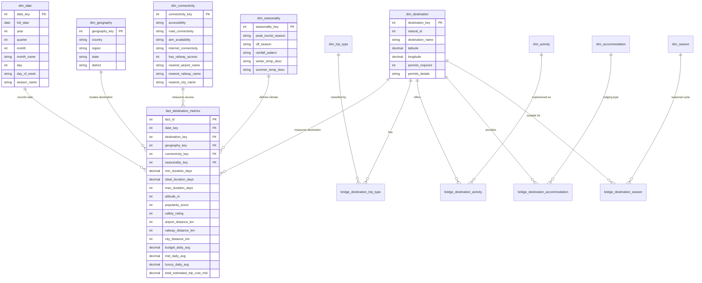

# Tourism Data Warehouse Star Schema Architecture

**Project**: Tourism Data Warehouse and Data Mining System (DMDW)  
**Schema Model**: Star Schema with Normalized Multi-Valued Bridge Outriggers  
**Target RDBMS**: MySQL 8.0 / SQLite Dual-Engine

---

## 1. Dimensional Architecture Overview

---

## 2. Dimension Hierarchies

1. **Geography Hierarchy**:
   `Country (India)` $\longrightarrow$ `Region (7 Zones)` $\longrightarrow$ `State (30 States/UTs)` $\longrightarrow$ `District` $\longrightarrow$ `Destination`

2. **Temporal Calendar Hierarchy**:
   `Year (2026)` $\longrightarrow$ `Quarter (Q1)` $\longrightarrow$ `Month (January)` $\longrightarrow$ `Day (12)`

3. **Accessibility & Infrastructure Hierarchy**:
   `Accessibility Level (Easy / Moderate / Difficult)` $\longrightarrow$ `Railway Access (Direct Rail / Island Route)` $\longrightarrow$ `Destination`

4. **Expenditure Tier Breakdown Hierarchy**:
   `Budget Tier (Budget / Mid-Range / Luxury)` $\longrightarrow$ `Expense Category (Accommodation / Food / Activities / Transport)` $\longrightarrow$ `Daily Amount (INR ₹)`

---

## 3. Grain & Integrity Specification

- **Primary Fact Grain**: Exactly one row per verified destination entity snapshot (100 rows).
- **Referential Integrity**: Every fact row links to valid non-null dimension records. Missing attributes map to `Unknown` dimension members with surrogate key `0`.
- **Zero Orphan Guarantee**: Foreign keys are enforced with relational constraints (`REFERENCES`).
- **Idempotency**: Schema DDL and loading scripts can be executed repeatedly without generating duplicate surrogate keys or fact records.
